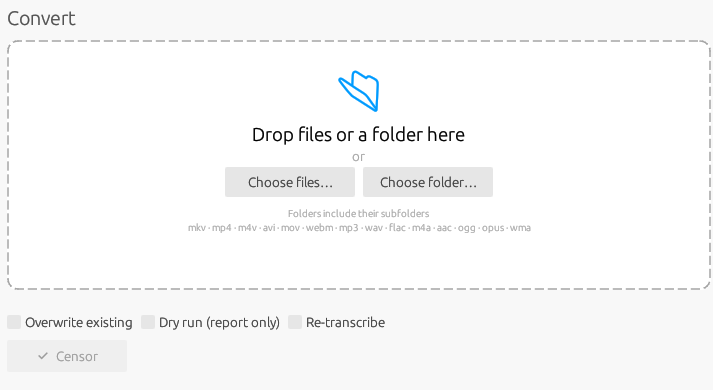
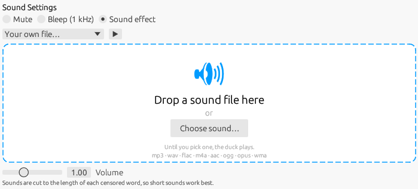
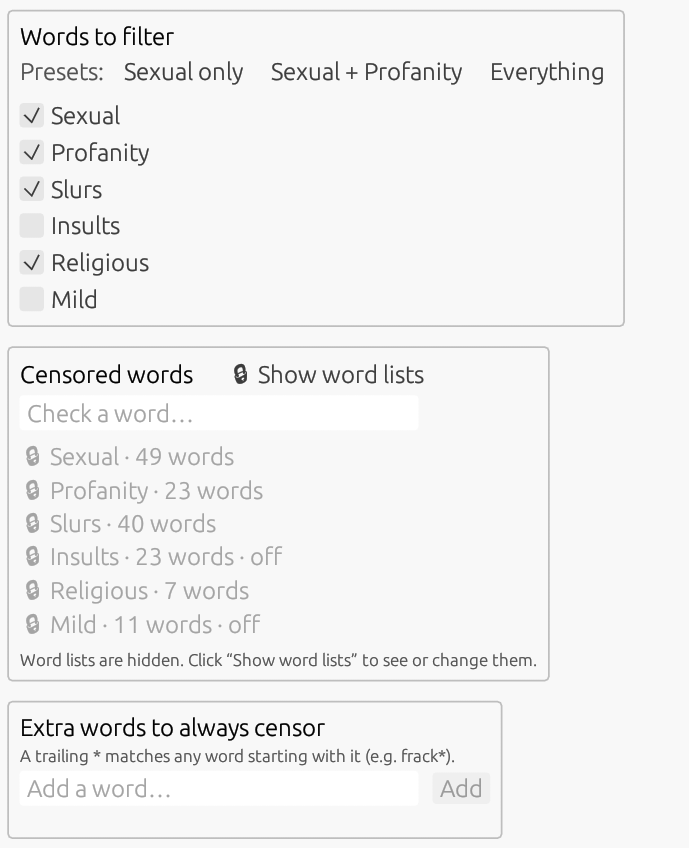
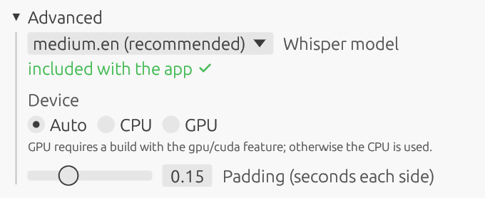

<div align="center">


**Clean up the language in your movies, shows, and music — automatically.**

MouthWash listens to your audio and video files, finds the words you choose, and
mutes, bleeps, or plays a sound effect over them. It all runs on your own PC.

[](#installation)
[](#built-with)
[](LICENSE)
[](https://github.com/nahobbs5/MouthWash/releases/latest)

### [⬇&nbsp; Download for Windows (.msi)](https://github.com/nahobbs5/MouthWash-Release/releases/latest)

or get the [**Python command-line script**](censor.py) for Windows, macOS or Linux
([setup required](#command-line-version))

</div>

---

## Contents

- [Overview](#overview)
- [Screenshots](#screenshots)
- [Features](#features)
- [Installation](#installation)
- [Quick start](#quick-start)
- [How it works](#how-it-works)
- [Output files](#output-files)
- [Tips for best results](#tips-for-best-results)
- [Built with](#built-with)
- [Building from source](#building-from-source)
- [Responsible use](#responsible-use)
- [License and credits](#license-and-credits)

## Overview

MouthWash is a Windows desktop app that makes a "clean" copy of a media file.
Drop in a movie, an episode, a whole season folder, or an album. MouthWash
transcribes the speech with OpenAI's Whisper model and finds every word on your
filter list. It then writes a new copy with those words muted, bleeped, or
covered by a sound effect.

- **Your original file is never changed.** MouthWash writes a separate
  `Name (clean)` file next to it.
- **Everything happens offline.** Speech recognition runs locally through
  [whisper.cpp](https://github.com/ggerganov/whisper.cpp), and nothing is
  uploaded. The internet is used for one thing only: the one-time Whisper
  model download, and you can skip even that by importing a model file.
- **Video, subtitles and chapters are untouched.** Only the audio track is
  re-encoded.

**Supported files**

| Type  | Extensions |
|-------|------------|
| Video | `mkv` `mp4` `m4v` `avi` `mov` `webm` |
| Audio | `mp3` `wav` `flac` `m4a` `aac` `ogg` `opus` `wma` |

## Screenshots

| Convert: drop files or folders | Settings: replacement sound |
|:---:|:---:|
|  |  |

| Settings: words to filter | Settings: Whisper model and device |
|:---:|:---:|
|  |  |

<!-- Uncomment this row once its screenshot is in docs/images/ (see docs/images/README.md).
| Convert: batch in progress | |
|:---:|:---:|
|  | |
-->


## Features

### Convert

- **Drag and drop** files or whole folders onto the window, or use
  **Choose files…** / **Choose folder…**.
- **Batch processing.** Folders are searched with all their subfolders, so you
  can queue a full TV season in one go. Earlier `(clean)` outputs and hidden
  folders are skipped automatically.
- **Live progress.** Each queued file shows its current stage:
  *Extracting audio → Loading model → Transcribing % → Matching words →
  Writing*. Two progress bars track the current file and the whole batch.
- **Per-file results.** Each file ends as *Done* (with how many words were
  censored), *No output*, *Failed* (hover for the reason) or *Cancelled*.
  Buttons open the finished file or its report in Explorer.
- **Batch options**
  - **Overwrite existing:** replace a `(clean)` file that already exists.
    Without it, files that already have one are skipped.
  - **Dry run (report only):** transcribe and write the report, without making
    a censored copy. Useful for previewing what will be caught.
  - **Re-transcribe:** ignore the cached transcript and run Whisper again.
- **Cancel** stops the current file and skips the rest. **Censor** again
  retries anything that failed or was cancelled. **Clear finished** tidies the
  list.
- A collapsible **Log** shows details for troubleshooting.

### Replacement sound

| Mode | What you hear |
|------|---------------|
| **Mute** | Silence for the length of the word (default). |
| **Bleep (1 kHz)** | The classic TV bleep tone. |
| **Sound effect** | A sound played over the word, cut to the word's length. |

The sound effects are **Duck quack, Fart, Boing, Slide whistle, Clown horn,
Cuckoo, and Robot beep**. You can also choose **🎲 Random mix**, which uses a
different built-in sound for each word, or **your own file** (any supported
audio format, dropped on the box or picked from a dialog). A **▶ preview**
button plays the selected sound, and a **Volume** slider (0–3×) adjusts how
loud it is.

### Words to filter

The built-in list is organized into six categories you can turn on or off:

| Category | Covers |
|----------|--------|
| **Sexual** | Sexual words, crude anatomy and slurs. |
| **Profanity** | Everyday swearing and insults. |
| **Slurs** | Racial, ethnic and miscellaneous slurs. |
| **Insults** | Name-calling and derogatory words about intelligence, disability or appearance. |
| **Religious** | Religious names used as exclamations, e.g. "Jesus!" or "goddamn". |
| **Mild** | Mild exclamations like jeez, gosh, darn and heck. |

**One-click presets**

| Preset | Categories |
|--------|------------|
| Sexual only | Sexual + Slurs |
| Sexual + Profanity *(default)* | Sexual + Profanity + Slurs |
| Everything | All six categories |

Slurs are part of every preset.

- **Hidden by default.** The word lists aren't shown until you click
  **🔒 Show word lists**, so nobody sees offensive words by accident. The lists
  lock again whenever you leave Settings.
- **Check a word.** Type any word to see whether it will be censored, which
  entry catches it, and why. If it isn't covered, add it with one click.
- **Skip individual words.** With the lists shown, click any word to stop
  censoring it, and click it again to restore it.
- **Extra words to always censor.** Add your own words. A trailing `*` matches
  any word that starts with it (`frack*` also catches *fracking* and
  *fracked*). MouthWash warns you if a word is already covered.

### Whisper model and device (Advanced)

| Model | Speed | Accuracy | Download size |
|-------|-------|----------|---------------|
| `small.en` | Fast | Lower | ~470 MB |
| `medium.en` *(recommended)* | Moderate | High | ~1.5 GB |
| `large-v3` | Slow | Highest | ~3 GB |

- **Download** a model inside the app, or use **Import model file…** (or drop
  a `ggml-*.bin` onto the window) if your network blocks Hugging Face.
  **Copy download link** gives you the URL to fetch it on another machine.
- **Device:** *Auto* tries the GPU first and falls back to the CPU. You can
  also force *CPU* or *GPU*.
- **Padding (0–0.5 s, default 0.15 s):** extra time muted before and after
  each word, so the start and end of a word don't slip through.

### App

- **Light**, **Dark** or **Match system** theme.
- Settings save automatically to `%APPDATA%\MouthWash\data\config.toml`.
- **Restore defaults** resets everything (Sexual + Profanity, `medium.en`,
  Mute, system theme) after asking you to confirm.

## Installation

1. Download the latest **`.msi`** from the
   [**Releases page**](https://github.com/nahobbs5/MouthWash/releases/latest).
2. Run it and follow the installer. It installs:
   - `mouthwash.exe`
   - **FFmpeg** (`ffmpeg.exe` and `ffprobe.exe`, with their license) in a
     `bin\` folder, so nothing else is needed
   - a Start Menu shortcut, and an optional desktop shortcut
3. Launch MouthWash. The first time, it asks you to **Download** the Whisper
   model (`medium.en`, about 1.5 GB). Models are saved to
   `%APPDATA%\MouthWash\data\models\` and are only downloaded once.

> **Note:** Windows SmartScreen may warn that the installer is from an
> unrecognized publisher. Choose **More info → Run anyway**. MouthWash is
> uninstalled from **Settings → Apps** like any other program.

**Requirements:** Windows 10 or 11 (64-bit) and about 2 GB of free disk space
for the default model. Any modern CPU works. A GPU makes transcription much
faster.

## Quick start

1. Open MouthWash and go to **Settings**. Pick a preset (or tick categories)
   and choose **Mute**, **Bleep**, or a **Sound effect**.
2. Go back to **Convert** and drop a movie, an audio file, or a folder onto the
   window.
3. *(Optional)* Tick **Dry run** first to see what will be caught.
4. Click **Censor**.
5. When a file shows **Done ✓**, click **📂** to open the folder that holds
   `Name (clean).mkv`.

## How it works

```
 your file ──▶ ffprobe ──▶ ffmpeg decode ──▶ Whisper ──▶ word match ──▶ ffmpeg write ──▶ Name (clean).mkv
               (layout)    (16 kHz mono)     (words +     (your filter   (mute / bleep /
                                              timings)     settings)      sound effect)
```

### FFmpeg's part

[FFmpeg](https://ffmpeg.org) does all the media reading and writing:

1. **Probe.** `ffprobe` reads the first audio track's channel count, sample
   rate and layout (stereo, 5.1, 7.1…).
2. **Decode for Whisper.** `ffmpeg` extracts that track as 16 kHz mono, which
   is what Whisper expects. On **5.1/7.1 surround** mixes it takes only the
   **center channel**, where dialogue lives, so explosions and music don't drown
   out the words.
3. **Write the clean copy.** `ffmpeg` runs an audio filter graph built from the
   flagged time spans. It turns the volume down to zero for each span, mixes in
   a 1 kHz tone, or overlays the chosen sound effect cut to the span's length.
   The original channel layout is kept.
   - **Video files:** video and subtitle streams are **copied untouched**. The
     audio is re-encoded to AAC (448 kbps) and saved as `.mkv`.
   - **Audio files:** saved in the source format (`mp3` → MP3, `flac` → FLAC,
     `wav` → WAV, `ogg`/`opus` → Opus, anything else → AAC).

MouthWash looks for `ffmpeg.exe` and `ffprobe.exe` next to the app first,
then in its `bin\` folder, then on your `PATH`.

### Whisper's part

[Whisper](https://github.com/openai/whisper) is a speech-recognition model.
MouthWash runs it through [whisper.cpp](https://github.com/ggerganov/whisper.cpp),
a fast C/C++ port, using the [`whisper-rs`](https://crates.io/crates/whisper-rs)
Rust bindings. It produces a transcript with a **start and end time for every
word**. The model loads once and is reused for every file in the batch.

Each transcribed word is checked against your settings, ignoring case and
punctuation. Each match becomes a span: the word's time, plus padding on each
side. Long spans are capped at 2 seconds, in case Whisper stretched a word over
a silence. Spans that overlap are merged into one.

## Output files

MouthWash writes up to three files **next to the source file**:

| File | What it is | When it's written | Safe to delete? |
|------|------------|-------------------|-----------------|
| `Name (clean).mkv` / `Name (clean).<ext>` | The censored copy. Video files become `.mkv`; audio files keep their extension. | When at least one word was found, and Dry run is off. | It's your result. Keep it. |
| `Name.words.json` | The **cached transcript**: every word Whisper heard, with its timing. | Every time a file is transcribed. | Yes. It's rebuilt next time, but transcribing is the slow part. |
| `Name.censor.txt` | A plain-text **report** of each censored span and the word(s) in it. | Every run, including dry runs. | Yes. |

The output folder can also be set with the `out_dir` entry in `config.toml`.

**Why the transcript is cached:** transcription takes most of the processing
time. When `Name.words.json` already exists, MouthWash skips Whisper and reuses
it. You can then change your word list, padding, or sound and re-run a movie in
seconds. Tick **Re-transcribe** (or delete the `.json` file) to force a fresh
transcript, for example after switching to a larger model.

<details>
<summary>Example <code>Name.words.json</code></summary>

```json
[
  {"start": 12.48, "end": 12.71, "word": "Get"},
  {"start": 12.71, "end": 12.90, "word": "out"},
  {"start": 12.90, "end": 13.22, "word": "of"},
  {"start": 13.22, "end": 13.60, "word": "here!"}
]
```

</details>

<details>
<summary>Example <code>Name.censor.txt</code></summary>

```
3 spans

0:04:12.330 -> 0:04:12.910   d***
0:17:45.020 -> 0:17:45.640   s***
1:02:03.100 -> 1:02:04.020   s*** / d***
```

The real report shows the full words.

</details>

## Tips for best results

- **Start with a Dry run.** Read the `.censor.txt` report to see what will be
  caught before making a copy. Your next real run reuses the transcript, so
  the dry run costs no extra time.
- **Pick the right model.** `medium.en` handles most movies and shows well. Use
  `large-v3` for heavy accents, mumbled dialogue, or songs over speech. Use
  `small.en` for quick passes on clear audio.
- **Use a GPU if you have one.** Transcribing a full movie on the CPU can take
  a long time. A GPU build (see [BUILD.md](BUILD.md)) is many times faster.
- **Hear the edges of words?** Raise **Padding** to 0.2–0.3 s.
- **Tweak, then re-run.** Changing words, presets, sounds or padding doesn't
  need a new transcript, so leave **Re-transcribe** off.
- **Keep sound effects short.** Each sound is cut to the length of the
  censored word, so long clips get chopped.
- **Surround sound is handled.** On 5.1/7.1 mixes Whisper listens to the
  dialogue channel, and the censoring is applied to every channel.
- **No speech recognizer is perfect.** Whisper can miss a word that's shouted
  over music or mishear a similar-sounding one. Check the report, and use
  **Extra words** or **skips** to fine-tune.

## Command-line version

[`censor.py`](censor.py) is the original Python script that MouthWash grew out
of. It uses the same pipeline (FFmpeg → Whisper → word match → FFmpeg) but
transcribes with [faster-whisper](https://github.com/SYSTRAN/faster-whisper)
instead of whisper.cpp. **It is usually faster than the app, but it has fewer
options.** It also runs on macOS and Linux, not just Windows.

### App vs. script

| | MouthWash app | `censor.py` |
|---|---|---|
| **Speed** | Good | **Faster** (faster-whisper) |
| **Platforms** | Windows 10/11 | **Windows, macOS, Linux** |
| **Setup** | One `.msi`; FFmpeg included | Python, faster-whisper and FFmpeg installed yourself |
| **Interface** | Drag-and-drop window with live progress | Terminal, one file or folder per command |
| **Folders** | Searches all subfolders | Top-level folder only |
| **File types** | Video and audio | Video only (`mkv` `mp4` `m4v` `avi` `mov`) |
| **Output** | `.mkv` for video; audio keeps its format | Always `.mkv` |
| **Word list** | Six categories, presets, check a word, skip words, extra words | One plain-text `words.txt` you edit by hand (the sample has about 30 entries) |
| **Replacement sound** | Mute, bleep, 7 built-in sounds, random mix, your own file, preview | Mute, bleep, or your own file (`--sound`) |
| **Models** | Download or import in the app | Downloaded automatically on first run |
| **Cancel / retry** | Buttons per batch | `Ctrl+C`, then run again |
| **Transcript cache and report** | ✅ | ✅ (same `.words.json` / `.censor.txt` files) |
| **Dry run, overwrite, re-transcribe** | ✅ | ✅ (`--dry-run`, `--force`, `--retranscribe`) |
| **Padding, model, device** | ✅ | ✅ (`--pad`, `--model`, `--device`) |
| **Language** | English | Any Whisper language (`--language`) |

### What you need

The script on its own isn't enough. You also need:

1. **Python 3** and the faster-whisper package:
   ```
   pip install faster-whisper
   ```
2. **FFmpeg**: `ffmpeg` and `ffprobe` must be on your `PATH`. The script stops
   right away if they're missing.
3. **A word list.** The script looks for `words.txt` in the same folder as
   `censor.py`. Copy [`Resources/words.txt`](Resources/words.txt) there, or
   point to it with `--wordlist`. Use one word per line; a trailing `*`
   matches any word that starts with it, and lines starting with `#` are
   ignored.
4. **Internet on the first run.** faster-whisper downloads the Whisper model
   the first time (`medium.en` is about 1.5 GB) and reuses it after that.

**Optional:** for an NVIDIA GPU, also run
`pip install nvidia-cublas-cu12 nvidia-cudnn-cu12`. Without it, the script uses
the CPU, which is slower. For `--sound`, bring your own audio file, for example
[`Resources/duck.wav`](Resources/duck.wav).

### Usage

```
python censor.py "Movie.mkv"                       # mute (default)
python censor.py "D:\Movies\Season 1" --bleep      # every video in a folder, bleeped
python censor.py "Movie.mkv" --sound duck.wav      # play a sound over each word
python censor.py "Movie.mkv" --dry-run             # transcribe and report only
python censor.py "Movie.mkv" --model large-v3 --pad 0.2
```

| Option | Default | What it does |
|--------|---------|--------------|
| `--wordlist FILE` | `words.txt` next to the script | Word list to use. |
| `--model NAME` | `medium.en` | Whisper model (`small.en`, `medium.en`, `large-v3`…). |
| `--device` | `auto` | `auto`, `cpu` or `cuda`. Auto tries the GPU, then the CPU. |
| `--language` | `en` | Spoken language. |
| `--pad SECONDS` | `0.15` | Extra time muted on each side of a word. |
| `--bleep` | off | 1 kHz tone instead of silence. |
| `--sound FILE` | — | Play this audio file over each censored word. |
| `--sound-volume X` | `1.0` | Volume multiplier for `--sound`. |
| `--out-dir DIR` | next to the source | Where to write the output files. |
| `--dry-run` | off | Write the report only, with no censored copy. |
| `--force` | off | Overwrite an existing `(clean)` file. |
| `--retranscribe` | off | Ignore the cached transcript. |

Run `python censor.py --help` to see the full list.

## Built with

| Component | Role |
|-----------|------|
| [**Rust**](https://www.rust-lang.org) (2021 edition) | The language the whole app is written in. |
| [**Cargo**](https://doc.rust-lang.org/cargo/) workspace | Builds two crates: `mouthwash-core` (platform-independent logic, unit-tested on any OS) and `mouthwash-app` (the Windows GUI and pipeline). |
| [**egui / eframe**](https://github.com/emilk/egui) 0.29 | Immediate-mode GUI framework for the interface. |
| [**whisper-rs**](https://crates.io/crates/whisper-rs) 0.14 → [whisper.cpp](https://github.com/ggerganov/whisper.cpp) | Local speech recognition with word-level timestamps. Optional `gpu` (Vulkan) and `cuda` (NVIDIA) features. |
| [**FFmpeg**](https://ffmpeg.org) | Probing, decoding, and writing the filtered audio and output files. |
| [rfd](https://crates.io/crates/rfd) | Native Windows file and folder dialogs. |
| [serde](https://serde.rs) + [toml](https://crates.io/crates/toml) / serde_json | Settings file, word list, and transcript cache. |
| [ureq](https://crates.io/crates/ureq) | In-app model download. |
| [directories](https://crates.io/crates/directories) | Finding `%APPDATA%` for settings and models. |
| [winresource](https://crates.io/crates/winresource) | Embeds the app icon into `mouthwash.exe`. |
| [cargo-wix](https://github.com/volks73/cargo-wix) + WiX Toolset v3 | Builds the `.msi` installer. |

## Responsible use

Only use MouthWash on audio and video files that **you own or have the legal
right to copy and modify**. You are responsible for making sure your use
complies with copyright law and with any license that applies to those files.

## License and credits

MouthWash is released under the [MIT License](LICENSE).
© 2026 Nathan Hobbs.

- **FFmpeg** is licensed under the GNU LGPL/GPL. The installer includes its
  license as `bin\FFmpeg-LICENSE.txt`. FFmpeg is a trademark of Fabrice
  Bellard.
- **whisper.cpp** is MIT-licensed, by Georgi Gerganov and contributors.
  Whisper models are by OpenAI, distributed in ggml format from
  [ggerganov/whisper.cpp on Hugging Face](https://huggingface.co/ggerganov/whisper.cpp).
- **faster-whisper** (used only by the `censor.py` command-line script) is
  MIT-licensed, by SYSTRAN. It isn't bundled with MouthWash; you install it
  yourself with `pip`, and it downloads its own Whisper models.
